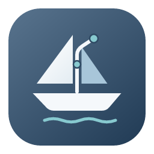
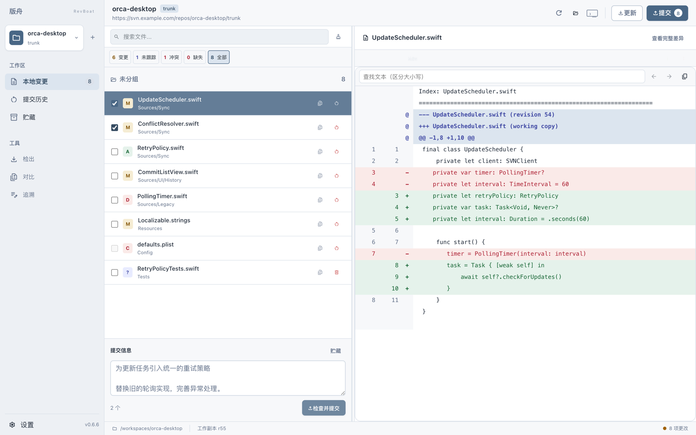
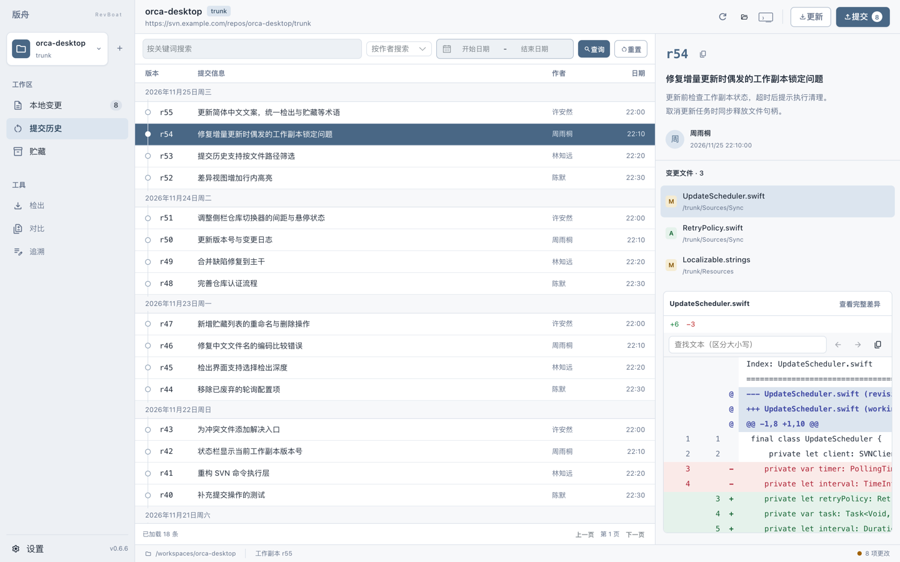
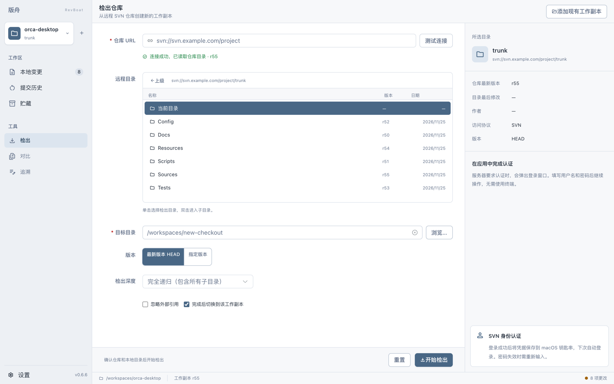
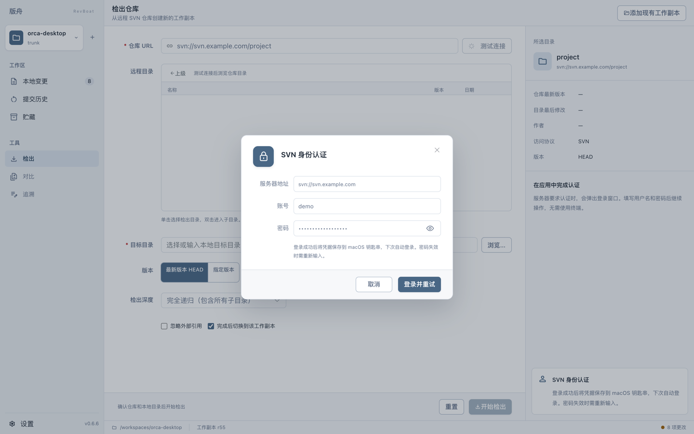
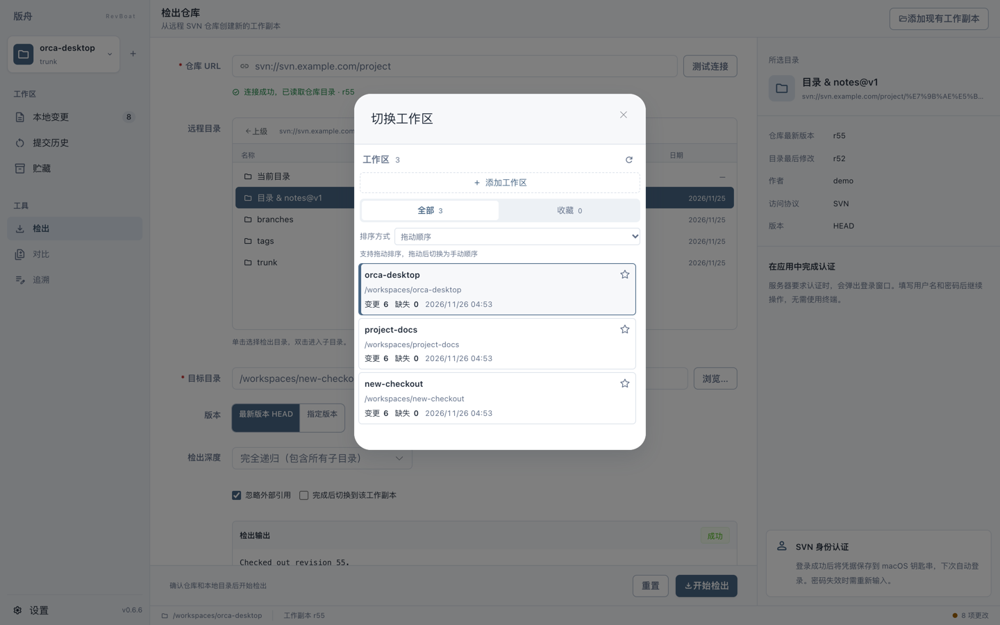
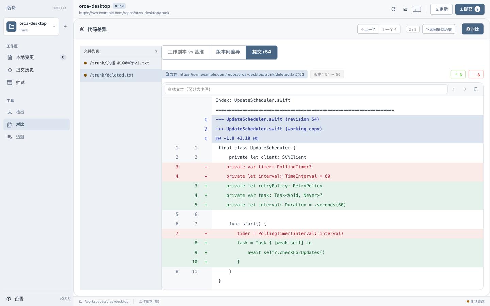
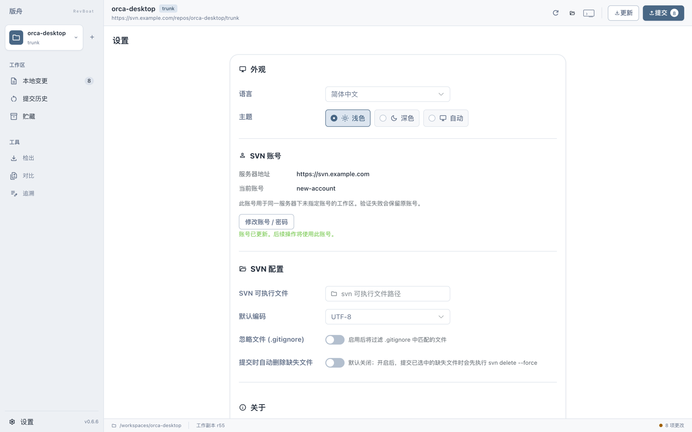

<p align="center">
  
</p>

<h1 align="center">版舟 RevBoat</h1>

<p align="center"><strong>SVN 桌面客户端 · 每一次改动，都有迹可循。</strong></p>

<p align="center">
  <a href="#界面预览">界面预览</a> ·
  <a href="#安装与运行">安装说明</a> ·
  <a href="#快速上手">快速上手</a> ·
  <a href="#操作手册">操作手册</a> ·
  <a href="https://github.com/x1376646336/RevBoat/releases">发行下载</a> ·
  <a href="https://github.com/x1376646336/RevBoat/issues">问题反馈</a>
</p>

版舟把 SVN 的日常操作集中到一个桌面工作台：打开项目、审阅修改、填写提交说明、查询历史和管理登录账号。适合使用 SVN 管理代码、配置、文档等项目文件的个人与团队。

项目基于 **OrcaSVN v0.6.6** 定制，使用 **Tauri 2、Rust、Vue 3 和 TypeScript**，重新设计了工作台界面，并改进了图形化认证、密码保存、工作区切换及历史文件对比。本手册对应当前 **0.6.6 定制版**。



> 截图来自实际前端，使用隔离的演示工作区。截图中的项目名、服务器、账号、提交记录和代码均为示例；安装包不包含模拟接口或演示仓库。

## 目录

- [功能概览](#功能概览)
- [界面预览](#界面预览)
- [安装与运行](#安装与运行)
- [快速上手](#快速上手)
- [操作手册](#操作手册)
- [常见问题](#常见问题)
- [当前功能边界](#当前功能边界)
- [开发与构建](#开发与构建)
- [项目来源与许可](#项目来源与许可)

## 功能概览

| 功能 | 可以做什么 |
| --- | --- |
| 工作区管理 | 打开已有 SVN 工作副本，按完整目录切换，收藏、排序、备注及移除列表记录 |
| 本地变更 | 按状态和路径查找修改，选择文件预览差异，勾选提交范围并填写说明草稿 |
| 提交检查 | 复核选中文件与说明，处理未跟踪文件，提交选定的本地修改 |
| 更新 | 查看本地版本、远端版本和待更新记录，获取远端修改并显示冲突提示 |
| 提交历史 | 按日期分组浏览，按作者、关键词及日期筛选，查看完整说明和变更文件 |
| 文件对比 | 查看工作副本差异、单次提交差异和版本区间差异，查找或复制 Diff |
| 检出仓库 | 测试连接、浏览远程目录、选择历史版本与检出深度、忽略外部引用 |
| 登录与账号 | 在界面输入账号密码；macOS 成功登录后保存到钥匙串；在设置中更换登录凭据 |
| 贮藏 | 在本机暂存支持的修改，应用、弹出或删除贮藏，导出文本 patch |
| 逐行追溯 | 查看文件每一行对应的历史版本、作者和内容 |
| 外部工具 | 打开项目目录、终端或已配置的编辑器 |
| 显示与偏好 | 简体中文、繁体中文、英文、日文、韩文；浅色、深色及跟随系统主题 |

## 界面预览

界面采用蓝灰色侧栏、紧凑工具栏与深蓝选中态。常用入口固定在左侧，文件列表与详情并排展示，减少在多个窗口之间切换。

| 区域 | 用途 |
| --- | --- |
| 左上角工作区卡片 | 识别当前项目，打开工作区切换列表 |
| 左侧导航 | 本地变更、提交历史、贮藏、检出仓库、对比、追溯和设置 |
| 顶部工具栏 | 刷新、打开方式、终端、更新和提交 |
| 主内容区 | 查看文件状态、提交记录、差异或操作表单 |
| 底部状态栏 | 确认当前工作副本路径、版本及本地状态 |

### 提交历史

按日期组织提交记录，右侧查看提交说明、变更路径及文件差异。



### 检出仓库

测试连接后浏览远程目录，确认本地目标目录、版本与检出选项。



### 仓库登录

服务器要求认证时，在弹窗中输入账号和密码，支持显示或隐藏密码。



### 工作区切换

列表直接展示目录名称与完整路径，点击目标条目即可切换。



### 历史文件对比

在完整对比页选择单次提交或版本区间，并使用文件列表切换目标。



### 账号设置

查看当前服务器与应用管理的账号，通过“修改账号 / 密码”验证并保存新凭据。



## 安装与运行

### 当前安装包

| 项目 | 说明 |
| --- | --- |
| 应用名称 | 版舟 RevBoat，应用文件为 `RevBoat.app` |
| 已验证平台 | Apple Silicon Mac（M 系列芯片），macOS 26 或更高版本 |
| SVN 运行环境 | 当前 macOS 安装包内置 SVN 1.15.0，通常无需单独安装 |
| 安装包名称 | `RevBoat_0.6.6_aarch64.dmg` |
| 签名状态 | 本地 ad-hoc 签名，未进行 Apple 公证 |
| Windows / Linux | 源码保留构建支持，当前定制版尚未完成原生安装包验收 |

到 [Releases](https://github.com/x1376646336/RevBoat/releases) 查看已发布的安装附件。**如果发行页尚无安装包，请按下文从源码构建。** 源码仓库不直接存放 DMG、依赖目录或编译产物。

安装步骤：

1. 退出正在运行的旧版 OrcaSVN 或 RevBoat。
2. 打开 DMG，将 `RevBoat.app` 拖入 `Applications`。
3. 从应用程序目录启动 RevBoat，打开已有工作副本或检出项目。

从本项目此前的 OrcaSVN 定制版升级时，工作区记录、偏好设置与钥匙串账号沿用原有存储标识。新名称不会自动删除旧的 `OrcaSVN.app`，请避免同时运行两者。

### 先区分三个位置

| 名称 | 示例 | 在哪里使用 |
| --- | --- | --- |
| 仓库地址 | `https://svn.example.com/project/trunk` | 检出、连接远程 SVN 服务器 |
| 工作副本目录 | `/Users/yourname/Projects/my-project` | 已经检出到本地、受 SVN 管理的项目目录 |
| SVN 可执行文件 | `/opt/homebrew/bin/svn` | 设置中的程序路径；这是可执行文件，不是项目文件夹 |

仓库地址和账号由项目管理员提供。版舟是客户端，不负责创建 SVN 服务端或注册服务器账号。

## 快速上手

### 已经有 SVN 项目

1. 点击左上角工作区卡片，选择“添加工作区”。
2. 选择已有 SVN 工作副本目录，通常是包含隐藏 `.svn` 目录的项目根目录。
3. 在“本地变更”查看当前修改；通过“提交历史”浏览已提交记录。
4. 首次执行需要认证的远程操作时，在登录弹窗中填写 SVN 账号和密码。

选择项目目录本身即可，不要选择 `.svn` 文件夹。普通目录不会因被添加到列表就自动成为 SVN 工作副本。

### 第一次取得项目

1. 进入左侧“检出仓库”，输入仓库 URL，点击“测试连接”。
2. 如弹出认证窗口，填写账号密码并点击“登录并重试”。
3. 在远程目录列表中选择要检出的目录，填写本地目标目录。
4. 保持默认的最新版本与递归深度，或按需要调整。
5. 点击“开始检出”，等待成功提示；勾选检出后切换选项时会打开新工作副本。

### 完成第一次提交

1. 点击顶部“更新”，检查并获取团队的远端修改。
2. 在编辑器中修改项目文件，回到版舟点击刷新。
3. 在“本地变更”选择文件，审阅右侧差异。
4. 勾选本次提交的文件，填写说明，点击“检查并提交”。
5. 在提交页再次核对范围和说明，确认提交。
6. 成功后到“提交历史”查看新记录，并检查工作区剩余修改。

## 操作手册

### 1. 管理与切换工作区

点击左上角工作区卡片展开目录列表，直接点击条目切换。相同目录名可以通过完整路径区分。

- **收藏**：点击星标，在“收藏”标签中集中查看常用项目。
- **排序**：选择手动、名称或修改时间排序；手动模式下可以调整顺序。
- **备注**：为项目补充便于识别的说明。
- **移除**：从最近工作区列表移除记录，不会删除磁盘上的项目。
- **打开方式**：使用已安装并配置好的编辑器、终端或文件管理器打开项目。

不同工作副本的未提交修改互相独立。切换工作区不会自动提交或同步这些修改。

### 2. 查看本地修改

“本地变更”提供状态分类、路径搜索、文件勾选及差异预览。点击文件名称可查看差异，勾选框用于选择提交范围。

| 状态 | 含义与处理方式 |
| --- | --- |
| 修改 | 已受版本控制的文件发生本地变化，审阅后提交、贮藏或还原 |
| 新增 | 已安排加入版本控制，尚未提交 |
| 删除 | 已安排从版本控制中删除，尚未提交 |
| 替换 | 原条目被新条目替换，需要核对完整操作范围 |
| 未跟踪 | 文件存在，但尚未加入版本控制；需要提交时先加入 |
| 缺失 | 受控文件在磁盘上不存在，需恢复文件或按删除流程处理 |
| 冲突 | 无法自动合并，需先解决冲突并标记解决后再提交 |

列表主要展示有状态变化的文件，不等于项目全部文件的目录树。刷新只核对本地状态，不会自动取得远端修改。

打开较大的工作区时，可能先显示缓存，再验证实际状态。出现待验证提示时，应等待完成；状态未确认前，部分写入操作会暂时不可用。

**还原与删除**：还原会丢弃目标的未提交修改；未跟踪文件的删除会直接删除本地文件，目录删除也包含子项，不进入回收站。需要保留内容时先备份。工作区搜索栏旁的清理按钮可执行 SVN Cleanup；应先确认没有其他 SVN 操作正在运行。

### 3. 检查并提交

“本地变更”中的“检查并提交”会将选中的文件和说明草稿带到提交页，最终提交需要在提交页确认。

- 检查已选总数和文件路径；被搜索或筛选隐藏的已选项仍可能属于提交范围。
- 未跟踪文件需要先加入版本控制；未跟踪目录可使用“加入版本控制并预览”检查其内容。
- 加入版本控制只是安排新增，取消提交后这些文件仍可能处于新增状态。
- 冲突文件不能直接提交。
- 删除或替换目录需要满足完整的目录操作范围；复制或移动目录不支持任意部分提交。
- “提交时自动删除缺失文件”默认关闭。启用后，仅将提交页勾选的缺失文件安排删除并提交。

提交说明示例：

```text
修复项目配置中的默认超时时间

调整连接超时配置，避免首次连接过早终止。
```

成功提交后，未选中的修改继续保留在本地。失败时先查看错误并刷新状态，再决定下一步操作。

### 4. 获取远端更新

点击顶部“更新”，查看本地版本、远端版本、列出的远端提交和本地更改。先检查记录，再点击页面内的“更新”。

更新会把远端内容合并到工作副本，不会提交你的本地修改。如果产生冲突，页面会列出相关路径；先处理冲突，再继续提交。

页面中的本地版本取自工作副本根目录，部分文件提交后该数字不一定立即变化；远端提交数量是当前页面列出的记录数，不代表仓库历史总数。

### 5. 查询提交历史与比较文件

进入“提交历史”，按作者、关键词或日期范围筛选，通过分页浏览记录。点击一条提交，右侧查看完整说明与变更文件，再点击文件预览本次修改；需要更多空间时进入完整对比页。

| 对比方式 | 适用场景 |
| --- | --- |
| 工作副本与基准 | 查看当前尚未提交的本地修改 |
| 单次提交差异 | 查看某次提交引入的变化 |
| 版本区间差异 | 比较同一目标在两个指定版本之间的变化 |

完整对比页可切换模式、输入版本号并点击“对比”；切换文件时保留已选版本区间。历史仓库地址不显示不适用的工作副本比较模式。

差异采用**统一视图**：`+` 表示新增行，`-` 表示删除行，上下文行帮助定位修改。支持差异查找和复制。空结果、读取错误与二进制文件分别显示不同提示。

**Word、Excel、PDF 等二进制文档暂不支持内容对比**，需要使用相应的文档比较工具。

### 6. 检出目录、版本与深度

连接成功后，远程目录列表采用逐级浏览：**单击选择检出目标，双击或按 Enter 进入目录**。右侧摘要可用于核对最终选择。

| 选项 | 说明 |
| --- | --- |
| 最新版本 | 检出仓库当前 HEAD |
| 指定版本 | 输入非负版本号，检出该历史版本 |
| 递归（`infinity`） | 检出目录下所有层级的内容，日常使用的默认值 |
| 直接子项（`immediates`） | 检出当前目录的文件和直接子目录，子目录不继续展开 |
| 仅文件（`files`） | 检出当前目录及其直接文件 |
| 空目录（`empty`） | 仅检出当前目录本身 |
| 忽略外部引用 | 检出时不处理 SVN externals |
| 完成后切换 | 成功后将新目录设为当前工作区 |

建议为新检出选择一个专用本地目录。再次打开已经检出的项目时，直接添加工作区即可。

### 7. 登录、保存密码与修改账号

对于需要账号密码的 `http://`、`https://` 和 `svn://` 仓库，认证弹窗会在远程操作需要登录时出现。**没有弹窗不一定是异常**：本地状态查看无需远程认证，已有可用凭据时也无需再次输入。

在 macOS 上，首次认证成功后会将凭据保存到系统钥匙串，后续启动自动尝试使用。密码失效时重新弹窗；若钥匙串保存失败，应用会提示，当前会话仍可继续使用。

修改登录凭据的入口：

**选择工作区 → 设置 → SVN 账号 → 修改账号 / 密码 → 验证连接并保存**

- 新凭据验证成功后才替换当前账号；验证失败保留旧账号。
- 页面不会回显已经保存的密码。
- 同一服务器下未指定用户名的工作区共用默认账号；不同协议、主机和端口分别处理。
- 仓库 URL 明确包含用户名时，只能更新该账号的密码。需要使用其他账号时，按界面提示重新检出工作副本。
- 这里修改的是**客户端使用的登录凭据**，不是修改服务器上的用户或密码。

`svn+ssh://` 使用外部 SSH 认证，本版没有新增 SSH 密码交互。其他平台的凭据目前仅保留在本次运行会话中。

### 8. 暂存修改：贮藏

临时中断工作时，可进入“贮藏”创建记录，选择支持的文本修改和未跟踪内容，填写名称，再点击“保存并从工作副本移除”。选中的修改保存后从工作副本移除，未选中的内容保留。

| 操作 | 结果 |
| --- | --- |
| 应用 | 将内容恢复到原工作区，保留贮藏记录 |
| 弹出并删除 | 应用成功后删除贮藏记录 |
| 删除 | 删除贮藏记录，不修改当前工作副本 |
| 复制或导出 patch | 复制或导出贮藏中的文本补丁部分 |

贮藏按本机工作区路径保存，不是仓库提交或团队共享备份。冲突、仅属性修改和受控二进制变更不支持此贮藏流程；patch 导出也不包含另存的未跟踪文件内容。

### 9. 逐行追溯

进入“追溯”，选择或输入文件，点击“加载”。表格显示行号、最后修改版本、作者和内容，可结合提交历史定位修改原因。它反映已提交历史，不代表当前未提交内容的作者归属。

### 10. 设置与软件更新

| 设置 | 说明 |
| --- | --- |
| 语言 | 简体中文、繁体中文、英文、日文、韩文 |
| 主题 | 浅色、深色、跟随系统 |
| SVN 账号 | 查看当前服务器，验证并修改登录凭据 |
| SVN 可执行文件 | 指向实际程序文件；当前 macOS 安装包通常可留空使用内置 SVN |
| 默认编码 | UTF-8、GBK、GB2312；不会自动重写项目文件的编码 |
| 忽略文件（`.gitignore`） | 对列表进行过滤，默认关闭，不修改 SVN 忽略属性 |
| 提交时自动删除缺失文件 | 默认关闭，启用后作用于提交页勾选的缺失文件 |

当前定制版通过新安装包更新，已关闭上游 OrcaSVN 的更新提示。**顶部“更新”按钮用于 SVN 工作副本更新，不是更新版舟软件。**

## 常见问题

| 问题 | 如何处理 |
| --- | --- |
| 不知道哪个目录是 SVN 工作区 | 选择之前检出的项目根目录，通常包含隐藏 `.svn` 目录；尚未检出则先使用“检出仓库” |
| 提示找不到 SVN | 当前 macOS 包包含运行时；先检查是否配置了失效的自定义路径。自编译版本需安装 SVN 或设置实际可执行文件路径 |
| 没有要求输入账号密码 | 本地操作无需登录，或已有有效凭据；需要更换账号时进入“设置 → SVN 账号” |
| 重启后还要求输入密码 | 检查是否出现钥匙串保存失败提示、密码是否已变更，以及系统是否允许应用访问对应钥匙串记录 |
| 历史中的文件无法对比 | 确认选中了文件和有效版本，查看页面错误；二进制文档不支持逐行内容比较 |
| 列表找不到新文件 | 查看未跟踪分类，清除路径搜索，检查 `.gitignore` 过滤后刷新 |
| 提交或还原按钮不可用 | 检查状态验证是否完成、当前是否已有操作，以及选中文件是否允许操作 |
| 更新后出现冲突 | 先处理文件内容，再通过支持的 SVN 工具标记解决，回到版舟刷新 |
| 工作副本被锁定 | 确认没有其他 SVN 操作，再尝试本地变更页面的清理入口；失败时根据 SVN 原始错误排查 |
| `.gitignore` 生效后文件仍受 SVN 管理 | 它仅过滤界面列表，不会取消版本控制，也不会自动设置 `svn:ignore` |
| 能否直接在软件里修改服务器密码 | 不能；设置页只更换客户端登录凭据，服务器密码需按团队流程修改 |

反馈问题时，请在 [Issues](https://github.com/x1376646336/RevBoat/issues) 提供系统版本、应用版本、操作步骤、预期结果和错误信息。截图或日志请先移除密码、令牌及不宜公开的仓库内容。

## 当前功能边界

- 当前交付验证集中在 **Apple Silicon / macOS 26+**；Windows、Linux 与其他 macOS 环境不能据此视为已验收。
- 对比使用统一文本差异视图，尚未提供左右并排对比、字符级高亮或 Office/PDF 内容比较。
- 尚未提供完整的 Switch、Merge、Resolve 图形操作入口；受控文件安排删除主要通过其他 SVN 工具处理，或使用已支持的缺失文件提交选项。
- macOS 支持钥匙串持久保存，其他平台目前为会话凭据；SSH 认证仍由外部 SSH 环境负责。
- 贮藏有内容类型与工作区路径限制，不替代提交或独立备份。

## 开发与构建

### 技术栈与目录

| 目录 | 内容 |
| --- | --- |
| `src/views/` | 本地变更、提交、历史、对比、检出、更新、贮藏、追溯和设置页面 |
| `src/components/` | 工作区选择、差异展示、账号设置等组件 |
| `src/api/` | SVN 调用封装与图形化认证流程 |
| `src/i18n/` | 五种语言的界面文案 |
| `src-tauri/src/svn/` | Rust SVN 执行、状态管理、认证与钥匙串存储 |
| `src-tauri/icons/` | 帆舟 SVG 源图及各平台图标 |
| `scripts/` | 运行时整理、构建、发布和界面检查脚本 |
| `tests/` | 前端逻辑测试 |
| `docs/images/revboat/` | 本手册使用的实际界面截图 |

### 启动桌面开发环境

准备 Node.js / npm、Rust 和对应平台的 Tauri 原生构建依赖。macOS 还需要 Xcode Command Line Tools；开发环境需能找到 SVN。后端集成测试另需 `svnadmin` 和 `svnserve`。

```bash
git clone https://github.com/x1376646336/RevBoat.git
cd RevBoat
npm ci
npm run tauri dev
```

只调试页面时可以运行 `npm run dev`；普通浏览器不提供 Tauri 原生能力，不能直接执行真实 SVN 操作。

### 构建与检查

```bash
# 前端类型检查与生产构建
npm run build

# 前端逻辑测试
npm run test:unit

# 后端测试
cargo test --manifest-path src-tauri/Cargo.toml

# 前端构建、单测、Rust 格式检查与后端测试
npm run check

# 从帆舟 SVG 重新生成应用图标
npm run icons
```

界面回归使用隔离的演示数据。先启动 `npm run preview -- --host 127.0.0.1 --port 1424`，再在另一终端运行以下命令；默认需要已安装的 Chrome：

```bash
npm run test:auth-ui
npm run test:desktop-ui
npm run test:diff-account-ui
```

### 打包带 SVN 运行时的 macOS 应用

先通过 Homebrew 安装 Subversion，准备一个尚不存在的运行时输出目录，再执行：

```bash
python3 scripts/stage-macos-svn.py /absolute/path/to/new-svn-runtime
APPLE_SIGNING_IDENTITY=- npm run build:with-svn -- /absolute/path/to/new-svn-runtime --bundles app
```

构建产物位于 `src-tauri/target/release/bundle/macos/RevBoat.app`。运行时会携带依赖及许可证；其最低系统要求取决于实际打包的二进制，当前交付包要求 macOS 26+。以上命令生成应用包，DMG 整理与 Apple 公证属于后续分发步骤。

实现与修复记录：[认证流程](docs/local-auth-fix.md) · [界面与功能修复](docs/local-ui-redesign.md) · [更名及数据兼容](docs/local-rebrand.md)。这些记录包含历史阶段说明，当前使用方式以本手册为准。

## 项目来源与许可

版舟基于 [wustites/OrcaSVN](https://github.com/wustites/OrcaSVN) v0.6.6 定制。图形化认证及运行时打包工作参考了 [firzen/StoneSVN](https://github.com/firzen/StoneSVN) 的相关实现；感谢上游项目及贡献者。

本项目采用 [MIT License](LICENSE)，保留原作者版权声明与 [上游 README](docs/upstream-readme.md)。随应用打包的 SVN 及其依赖遵循各自许可证，对应声明随运行时一并提供。
